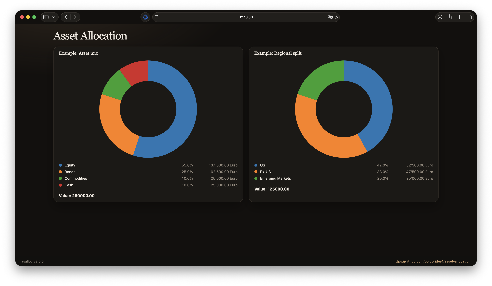

# asset-allocation

> **Disclaimer — Not Financial Advice.**
> This tool is provided `AS-IS`, without warranty of any kind, for informational
> purposes only. Prices, splits, and scraped data may be wrong, delayed, or
> unavailable. Do not make financial decisions solely on its output — verify
> independently and consult a licensed advisor. The authors accept no liability
> for financial loss or damages from its use. See `LICENSE`.

## Description

Self-hosted portfolio dashboard: load holdings from JSON, sync live prices, geosplits, sectors and broker balances, then explore allocation in the web UI.



## Setup

```bash
make install
```

Requires Python 3.10+. Dependencies include `numpy`, `matplotlib`, `yfinance`, `playwright`, `ccy`, `curl_cffi`, `pycountry`, and `pytr`.

## Holdings file

The holdings file is keyed by **user**: each top-level key is a user name, and its value holds that user's portfolio buckets.

```json
{
  "default": {
    "equity_portfolio": [ { "ISIN": "IE000BI8OT95", "shares": 220, "value": null } ],
    "bond_portfolio": []
  }
}
```

The user name comes from `config.ini` (`[update] user = default`) and can be overridden per run with `--user NAME`. Charts are per user too: an update writes to `<output_dir>/<user>/`, and the server serves the selected user's charts.

The store itself is backend-agnostic: the code above the storage layer only talks to `storage.repositories.AssetRepository`, and the concrete backend is chosen in one place (`storage/wiring.py`) from the `[server] backend` setting in `config.ini`:

| `[server] backend` | Meaning |
| --- | --- |
| `json` (default) | Holdings in the JSON file named by `[update] assets_file` |
| `postgres` | Not implemented yet: the wiring logs an error and the store fails to open |

`[server] postgres_dsn` holds the connection string for the future Postgres backend (`postgresql://localhost/asalloc` by default).

| Key | Purpose |
| --- | --- |
| `equity_portfolio` | Equity positions (used for DM/EM and US splits) |
| `fixed_maturity_bond_portfolio` | Fixed-maturity bonds |
| `cash_portfolio` | Cash / emergency fund |
| `bond_portfolio` | Other bonds |
| `commodity_portfolio` | Commodities |
| `pension_portfolio` | Pension |

Each bucket is an array of position objects. Typical fields:

| Field | Meaning |
| --- | --- |
| `ISIN` | Identifier for price lookup (may be `null` if you only use `value`) |
| `shares` | Units held (optional if `value` is set) |
| `value` | Fixed position value in account currency (optional if priced from ISIN) |
| `broker` | Broker label (used by implementations where relevant) |
| `dmem` | Share of position treated as **developed** markets (0–1) |
| `dmem_other` | When a country is “other”, fraction treated as developed (0–1) |
| `usavn` | Within developed markets, fraction attributed to the **US** (0–1) |

`assets.json` is listed in `.gitignore` so you can keep real balances private; `assets.sample.json` is a redacted starting point (it ships with the `default` user).

### Migrating an old holdings file

A pre-user file (buckets directly at the top level) is rejected with a pointer to the migration script. Run it once per file — it backs the original up before writing:

```bash
python scripts/migrate_assets_user.py ~/.local/asalloc/assets.json default
```

The script touches only the file you pass (plus its `.bak` sibling), never `config.ini` or anything else in your home directory.

> The `?user=` selector on the web server is **not authentication**: anyone who can reach the server can read and edit any user's holdings. Keep it on a trusted network.

## Price source

Positions are built through `position/factory.py` (JustETF by default, Yahoo Finance via `yfinance` for some ISINs). With `--fetch-prices`, quotes are written to `cache.json` (also gitignored). `--fetch-geosplit` refreshes country weights and `--fetch-sectorsplit` refreshes sector weights in the same cache.

## Run

From the repository root, after `make install`:

```bash
asalloc update
```

Useful `update` flags:

| Flag | Purpose |
| --- | --- |
| `--config PATH` | Use a `config.ini` other than `$ASALLOC_CONFIG` (may go before or after the subcommand) |
| `--fetch-prices` | Scrape live quotes into `cache.json` |
| `--fetch-geosplit` | Scrape country allocations into `cache.json` |
| `--fetch-sectorsplit` | Scrape sector allocations into `cache.json` |
| `--fetch-oskar` / `--fetch-scalable` / `--fetch-tr` | Scrape broker holdings |
| `--user NAME` | Portfolio user to read and write (default: `config.ini` `[update] user`, else `default`) |
| `--assets-file PATH` | Use a holdings file other than `assets.json` |
| `--plot {web,pie-chart}` | Chart backend (default `web`) |

## Web visualizer

The default chart backend (`WebChart`) writes one JSON `*.raw` file per pie into `~/.local/asalloc/visualizer/data/<user>/` (the `[plotter] output_dir` plus the user subdir). Scaffold the JS app (without touching existing raw files) with:

```bash
make web
```

Then run `asalloc update` and serve the visualizer over HTTP (browsers cannot list `file://` directories):

```bash
make serve
# or
asalloc serve
```

Stop it with `make stop-serve`. Open `http://localhost:8765/dashboard` for the charts — the incognito button blurs Euro figures in place (instant CSS toggle, no reload; `?incognito=true` carries the pressed state through the constituents round trip) and never changes the data. The constituents page has the same button, blurring Value/Shares figures there. Add `?user=NAME` to view another user's portfolio (charts and holdings); an unknown user gets a 404.

`http://localhost:8765/constituents` shows the holdings from `assets.json` (prices from `cache.json`) as tables with editable shares/value boxes. Changing a box (Enter, Tab, or click-away) persists to `assets.json` via `POST /api/constituents` — empty means `0`, editing shares also clears the stored value so the next update recomputes it from shares × cached price, locked cells are rejected server-side, and the cell flashes on success or reverts on failure. Use `asalloc serve --assets-file PATH --cache-file PATH` to point the endpoint at other files.

Clicking Dashboard runs a lite refresh first — but only if a cell was edited since the page loaded, in which case it navigates to the dashboard once the refresh completes (`POST /api/update`: no scraping flags, log level ERROR). With no edits it navigates straight to the dashboard.

Editing shares immediately recomputes value as shares × cached price (and vice versa), so the file always holds a consistent pair; without a cached price the sibling is left untouched and the edited box gets a red flare. Empty means `0`, locked cells are rejected server-side, and a normal save flashes green then reverts on failure. A missing cached price is live-fetched once for that position and written back to the cache. For admin use, `make service` also copies `systemd/asalloc-lite-update.service` (same lite update) but leaves it disabled — start it yourself when needed.

The dashboard's Sync Prices button posts `{"mode": "fat"}` to the same endpoint for a fat refresh (live prices, geosplits, and sectorsplits; broker scrapes never run there). It takes minutes and reloads the gallery when done. Leaving via Edit fires `POST /api/cancel` with `keepalive` and navigates immediately without waiting for it; only one endpoint update runs at a time, timer/systemd runs are unaffected.

The app is a single document at `/dashboard`: the view is frontend state in the hash (`#constituents`, or absent for the dashboard), while `?incognito=` stays backend-tracked. Opening `/dashboard#constituents` directly jumps into the constituents view, but a reload always defaults back to the dashboard. The first Edit click fetches the constituents markup once; afterwards switching (clicks and Back/Forward, via `hashchange`) swaps cached views in place with no document reload. Freshness is verified on every show — the dashboard re-renders when the chart signature changed, the constituents page revalidates in the background without touching open drafts or focused inputs — and any fetch failure falls back to a classic navigation. All responses carry `Cache-Control: no-cache`, so deploys and updates take effect without ever clearing browser data. The dashboard also paints its last gallery from a per-tab snapshot on cold loads, and chart payloads load in parallel. Editing a cell still runs the lite refresh before showing the dashboard — that part is unavoidable.

The bind address, HTTP port, and directory come from `config.ini` (`[server] address`, `port`, and `directory`; defaults `localhost`, `8765`, and `~/.local/asalloc/visualizer`). The server runs in the background.

| Target | What it does |
| --- | --- |
| `make install` | `pip install -e .`, plus a `~/.local/bin/asalloc` symlink to wherever `pip` put the entry point (venv/conda-aware, so systemd finds it) |
| `make web` | Copy `visual/web/frontend` into `~/.local/asalloc/visualizer`, stamp version and GitHub URL |
| `make web-example` | Same, plus sample `*.raw` files (no server, no browser) |
| `make serve` | Scaffold the web app, then background HTTP server for the visualizer dir (from `config.ini`); fails if `asalloc` is not callable |
| `make clean` | Same as `make web-clean` (so `make clean web` rebuilds the visualizer from scratch) |
| `make stop-serve` | Stop the background visualizer server |
| `make service` | Linux: install systemd user units, enable serve + 3-hour update timer |
| `make stop-service` | Linux: stop and disable those user units |
| `make web-clean` | Delete `~/.local/asalloc/visualizer` |

On a headless Debian box, after `make install` and `make service`, put holdings at `~/.local/asalloc/assets.json` and enable lingering so the user units run without a login:

```bash
sudo loginctl enable-linger "$USER"
```

Units live in `systemd/` (`*.service` / `*.timer` for systemd) and are copied to `~/.config/systemd/user/`.

To use matplotlib windows instead, pass `--plot pie-chart` (or set `DEFAULT_VISUALIZER` in `visual/__init__.py`).

## License

Licensed under `AGPL-3.0-or-later` — see `LICENSE`. If you run a modified
version as a backend/network service, you must offer the modified source
to its users.
